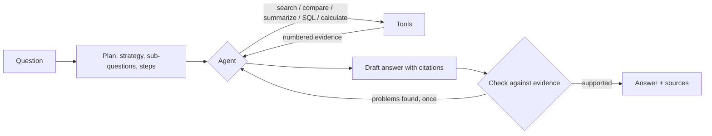

# Agentic RAG System

An assistant that plans before answering, chooses how to retrieve, uses tools, checks its own answer and cites its sources. It works over a multi-document knowledge base and accepts questions in English or Arabic.

Demo video: [demo/agentic_rag_demo.mp4](demo/agentic_rag_demo.mp4)

## Run it

Python 3.10 or newer.

```powershell
py -3.10 -m venv .venv
.\.venv\Scripts\python.exe -m pip install -r requirements-dev.txt
Copy-Item .env.example .env
```

Put a free key from https://console.groq.com/keys in `.env`, then:

```powershell
.\.venv\Scripts\python.exe -m streamlit run app.py
```

The first start downloads a 120 MB embedding model and builds the index. Later starts only re-index files that changed.

## How it works



### Knowledge base pipeline (`rag/ingest`)

| Step | File | What it does |
|---|---|---|
| Extraction | `extract.py` | PDF (headings by font size, tables), Word, Markdown, text, CSV, Excel |
| Cleaning | `clean.py` | Unicode, running headers and footers, page numbers, hyphenation, spacing |
| Chunking | `chunk.py` | Splits by section and page, 900 characters with 150 overlap |
| Embedding | `embed.py` | `multilingual-e5-small`, quantized ONNX, on CPU |
| Storage | `store.py` | Chroma, persistent, cosine similarity |

`pipeline.py` runs the steps and skips unchanged files by hash.

### Retrieval (`rag/retrieval.py`)

Semantic search, BM25 keyword search, and a hybrid of both using reciprocal rank fusion. The agent picks the mode and can limit a search to chosen documents.

### Tools (`rag/tools.py`)

| Tool | Purpose |
|---|---|
| `search_knowledge_base` | Find passages, with mode and document filter |
| `compare_documents` | Passages on one topic from several documents side by side |
| `summarize_document` | Summarize a whole document |
| `analyze_data` | Read-only SQL over CSV and Excel files |
| `calculate` | Exact arithmetic |
| `list_documents` | What the knowledge base contains |

SQL runs on an in-memory copy with only SELECT allowed and a five second limit. The calculator parses arithmetic only and never executes code.

### Agent (`rag/agent.py`)

1. **Plan.** Classifies the question as direct, single lookup or multi-step, and writes sub-questions and steps.
2. **Act.** Calls tools for up to 7 steps, refining queries when results are not enough.
3. **Check.** A second model compares the answer with the evidence.
4. **Revise.** If something is unsupported or missing, the agent gets one more round to fix it.

Citations that do not match a real source are removed. `rag/llm.py` waits on rate limits and falls back to other Groq models.

## Standard RAG and Agentic RAG

| | Standard RAG | Agentic RAG |
|---|---|---|
| Flow | Fixed: retrieve once, then answer | Plans, then loops until it has enough |
| When to retrieve | Always | Decides; skips it for greetings |
| Query | The raw question | Split and rewritten |
| Retrieval | One semantic search | Semantic, keyword or hybrid, per document |
| Tools | None | Search, compare, summarize, SQL, calculator |
| Multi-step questions | Often incomplete | Handled step by step |
| Self-check | None | Checks evidence and revises |
| Cost and speed | One call, fast | Several calls, slower |

The **Standard vs Agentic** view in the app runs both on the same question.

## Sample documents

Eleven files about a fictional company, Nilora Electronics: two annual reports, HR handbook, travel, security, warranty, and two versions of the remote work policy, a company overview, plus sales and employee data. They were made by `scripts/generate_documents.py`. The annual report figures are computed from the sales data, so prose and data agree.

## Tests and evaluation

```powershell
.\.venv\Scripts\python.exe -m pytest -q tests
.\.venv\Scripts\python.exe scripts\evaluate.py --retrieval-only
.\.venv\Scripts\python.exe scripts\evaluate.py
```

The tests use a scripted model, so they need no key. The full evaluation runs 13 questions through both systems and writes `eval/results.md`. It needs a Groq key.

## Deploy to Streamlit Community Cloud

1. Push the project to GitHub. `.env` is already ignored.
2. On https://share.streamlit.io choose the repository and `app.py`.
3. In Advanced settings choose Python 3.10 to 3.12, and in Secrets add `GROQ_API_KEY = "..."`.

On a public deployment every visitor shares the same key, quota and uploaded files, and uploads are lost when the app restarts.

## Limits

- Scanned PDFs need OCR first.
- The Groq free tier allows about 8,000 tokens per minute per model, so a complex question may pause or switch model.
- The reviewer is also a language model. It reduces unsupported answers and cannot rule them out.
